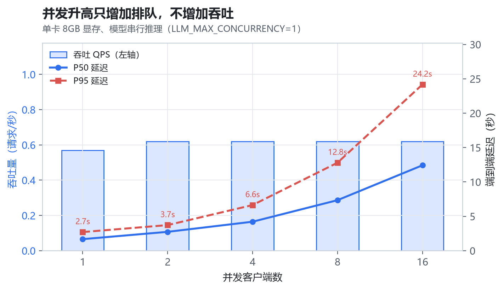
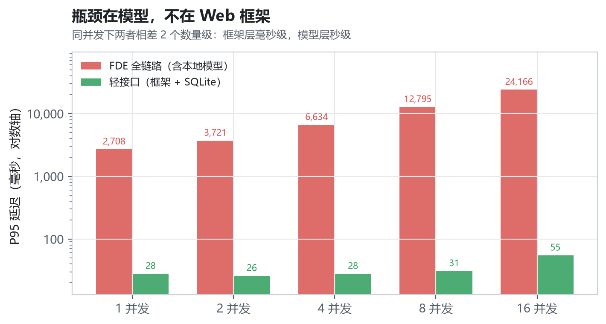
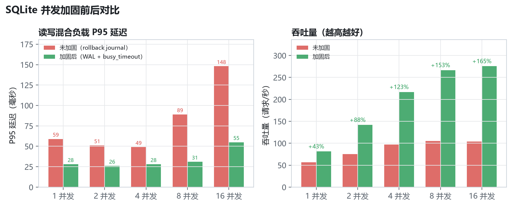
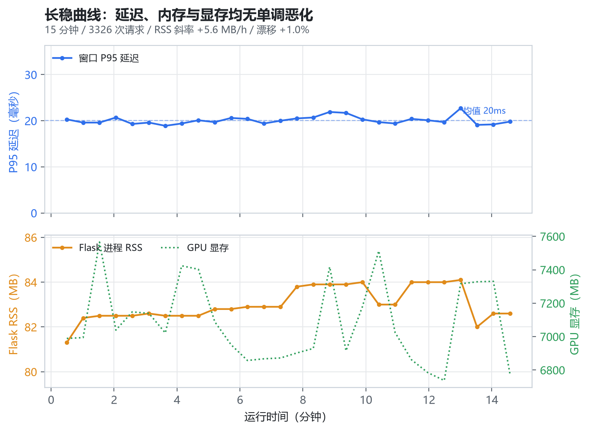

# 并发与长稳测试

> 对应脚本：`scripts/bench_concurrency.py`（并发压测）、`scripts/soak_test.py`（长稳）、`scripts/plot_bench.py`（出图）
> 原始数据：`data/conc_optimized.json`、`data/conc_baseline.json`、`data/soak_report.json`
> 图表：`docs/img/fig7_1~4`
> 测试时间：2026-10-19　环境：Ryzen 9 7945HX / 16GB / RTX 4060 Laptop 8GB / Ollama 0.40.5 / qwen3:8b (Q4_K_M) / Flask 3.1.3 / SQLite(WAL) / Windows 11

---

## 1. 为什么要单独测并发和长稳

`docs/03` 评的是拆解准确率，`docs/06` 评的是单条请求的业务后果。两者都是**一次一条**，回答不了基层场景里最要命的两个问题：

1. **集中录入扛不扛得住**。早会散会、月底报表、迎检前突击，几个网格员会同时往系统里灌话。单卡 8GB 显存只有一张 GPU，模型推理是串行的——并发一上来，是排队、降级、还是直接报错？
2. **连续跑几天会不会越来越慢**。SQLite 的 WAL 文件会不会无限膨胀？Flask 线程、数据库连接、模型进程的内存会不会只涨不落？这些只有跑够时间才看得见。

这两件事都不是"功能对不对"，而是"能不能上线"。所以单独成章。

---

## 2. 测试方法

### 2.1 被测对象与部署形态

```
压测客户端（多线程，每线程独立会话）
        │  HTTP  →  127.0.0.1:5057
        ▼
Flask 3.1.3（werkzeug 开发服务器，threaded=True，单进程）
        ├── 鉴权/RBAC → SQLite（WAL 模式）
        └── 调模型    → Ollama 0.40.5 → qwen3:8b（GPU，runner.parallel=1）
```

压测脚本自起实例（`--spawn`），独立端口 + 独立数据库，**每次从空库开始**。这样计数可复现，也不会污染演示库 `data/community.db`。

### 2.2 两种负载，用来分离"框架"和"模型"

| 负载 | 请求构成 | 测什么 |
|---|---|---|
| `full` | `POST /api/fde` 全链路：脱敏 → 拆解（调模型）→ 派单 → 填报 → 审计 | 真实业务下的端到端能力 |
| `light` | 4 读 1 写混合：健康探针、统计、工单列表、台账列表、写探针 | 框架 + 数据库自身的并发能力 |

`light` 里的写探针（`POST /api/health/dbwrite`，只在 `APP_TEST=1` 时可用）只写一条审计日志，把"数据库写并发"从业务链路里单独隔离出来——否则读请求太快，写锁竞争会被平均掉。

### 2.3 并发度是"严格并发"，不是"线程数"

每档并发 N，任务按 N 个一批提交，**一批全部返回再提交下一批**。保证同一时刻在飞请求数恰好等于 N，不会因为任务跑得快而虚高。

### 2.4 落库一致性：不看响应，看库

并发下最容易出的两类事故，延迟指标完全看不出来：

- 响应 200 但**没落库**（事务被并发打断、session 串了）
- 同一个请求**写了两遍**（重试未去重）

所以每一档跑完都对比"响应求和"与"库表增量"：

```
成功请求数      == fde_record 增量
Σ 响应.items    == work_item  增量
Σ 响应.orders   == work_order 增量
```

对不上就说明有丢写或重写，此时延迟再漂亮也没有意义。

### 2.5 三个必须提前排掉的测量陷阱

做这类测试，工具本身引入的偏差经常比被测系统的差异还大。这次踩了三个，都记下来：

**① 登录的 PBKDF2 会污染首批延迟。**
每档重建线程池时，每个线程第一次请求都要先登录（werkzeug 默认 PBKDF2 26 万轮，约 100ms，且受 GIL 串行）。8 个线程同时登录 ≈ 800ms 的长尾，会全部砸进第一批的 P95。第一次测 `light` 模式时 P95 是 604ms，改成**线程池全局复用 + 开测前用 Barrier 让 N 个线程各登录一次**后，P95 降到 25ms——**24 倍的差距全是测量方式带来的**。

**② keep-alive 旧连接会把测试工具的问题记到服务端头上。**
初版复用 `requests.Session` 的长连接，在长耗时请求下并发 16 时出现 `conn_error`。查服务端日志发现请求根本没到。原因是开发服务器回收了空闲长连接，客户端复用了已关闭的 socket。压测客户端统一加 `Connection: close` 后消除。**这是测试工具的问题，不是系统的问题**——如果不查日志就下结论，会误判成"系统扛不住 16 并发"。

**③ 小样本会让结论反向。**
用每档 4 个请求标定"模型闸门并发度"时，`LLM_MAX_CONCURRENCY=2` 的 P95（6.0s）明显好于 `=1`（17.7s），看起来"开 2 路并行能快 3 倍"。把每档加到 12 个请求重测，两者**完全一致**（QPS 均 0.60，P95 13.4s vs 13.0s）。4 个请求时，第一批只排了 2 个，恰好被并行吃掉，属于采样偏差。Ollama 日志也证实 `runner.parallel=1`，物理上就没有并行。**结论：并发类指标每档样本不能少于 2 批。**

---

## 3. 全链路并发结果

16 请求/档，语料为 12 条真实社区口述轮转（1~3 个业务项），模型热态。

| 并发 | 请求 | 成功 | QPS | P50 | P90 | P95 | P99 | 最大 | 降级 |
|:--:|:--:|:--:|:--:|--:|--:|--:|--:|--:|:--:|
| 1 | 16 | 16 | 0.57 | 1676 | 2359 | 2708 | 2726 | 2730 | 0 |
| 2 | 16 | 16 | 0.62 | 2741 | 3384 | 3721 | 4475 | 4664 | 0 |
| 4 | 16 | 16 | 0.62 | 4212 | 6311 | 6634 | 7396 | 7586 | 0 |
| 8 | 16 | 16 | 0.62 | 7344 | 12232 | 12795 | 13627 | 13835 | 0 |
| 16 | 16 | 16 | 0.62 | 12418 | 22868 | 24166 | 25361 | 25660 | 0 |

> 延迟单位 ms。降级 = 响应中 `llm_used=false`（模型排队超时后走规则兜底）的次数。



### 3.1 吞吐完全饱和，加并发只加排队

QPS 从并发 1 的 0.57 到并发 16 的 0.62，**基本是一条水平线**。这是单卡串行推理的必然结果：GPU 一次只能算一个请求，吞吐上限 = 1 / 单请求耗时 = 1 / 1.61s ≈ 0.62 req/s。加多少并发都突破不了。

延迟则严格按"批内串行"增长。设单请求耗时 t=1.61s，一批 N 个请求串行处理，第 k 个完成时间约 k·t，于是：

| 并发 | 理论 P50（N/2·t） | 实测 P50 | 理论 P95（0.95N·t） | 实测 P95 |
|:--:|--:|--:|--:|--:|
| 1 | 0.8s | 1.68s | 1.5s | 2.71s |
| 4 | 3.2s | 4.21s | 6.1s | 6.63s |
| 8 | 6.4s | 7.34s | 12.2s | 12.80s |
| 16 | 12.9s | 12.42s | 24.5s | 24.17s |

并发 ≥4 时误差均在 5% 以内（并发 1 只有 1 个请求，"第 k 个"模型不适用）。**实测曲线能被一个只有 t 一个参数的串行模型解释，说明链路上没有隐藏的锁竞争或资源抖动**——瓶颈干净地落在模型推理这一处。

### 3.2 落库一致性

| 项目 | 期望 | 实际 | 结果 |
|---|--:|--:|:--:|
| 成功请求 → FDE 记录 | 80 | 80 | ✅ |
| Σ 业务项 → work_item | 115 | 115 | ✅ |
| Σ 工单 → work_order | 50 | 50 | ✅ |
| 台账 | — | 85 | — |
| 审计 | — | 280 | — |

零丢失、零重复。并发再高，写库这条线是干净的（前提是下一节那个问题已修）。

---

## 4. 框架层 vs 模型层

同样的并发档位打轻接口：

| 并发 | 轻接口 QPS | 轻接口 P95 | 全链路 QPS | 全链路 P95 |
|:--:|--:|--:|--:|--:|
| 1 | 81.2 | 28ms | 0.57 | 2708ms |
| 2 | 141.7 | 26ms | 0.62 | 3721ms |
| 4 | 216.7 | 28ms | 0.62 | 6634ms |
| 8 | 266.4 | 31ms | 0.62 | 12795ms |
| 16 | 275.5 | 55ms | 0.62 | 24166ms |



轻接口的 QPS 从 81 一路涨到 275（并发 16 时受单进程 GIL 与 SQLite 写锁限制开始走平），P95 始终在 55ms 以内；全链路的 QPS 卡死在 0.62，P95 涨到 24 秒。**同一套框架、同一个数据库，差 440 倍**。

结论很明确：

- **不要优化 Flask**。单进程 werkzeug 在 16 并发下 P95 只有 55ms，社区几十个人的并发量连零头都用不到。
- **瓶颈在本地模型的串行推理**，而这是 8GB 单卡的物理约束，换框架、加线程、调参数都解决不了。
- 要提升这个数字，只有两条路：换更强的卡（提高并行度），或者**把同步等待改成异步受理**（第 7 节）。

---

## 5. 三个工程发现

这一节是本次测试真正的产出——三个问题都不是"功能 bug"，单请求测试永远碰不到。

### 5.1 事务边界：模型推理的 2 秒里，写锁一直被占着

**现象**：并发 16 时，16 个请求只有 14 个成功，2 个返回空响应。客户端报 `Expecting value: line 1 column 1`，查服务端日志：

```
sqlalchemy.exc.OperationalError: (sqlite3.OperationalError) database is locked
[SQL: INSERT INTO audit_log (actor, agent, action, ...) VALUES (?, ?, ?, ?, ?, ?)]
```

**根因**：`Orchestrator.handle_fde()` 原来的写法是

```python
db.session.add(rec)
db.session.flush()          # ← INSERT 已发出，事务仍然开着，写锁被本请求持有
parsed = self.parser.run(...)   # ← 这里面调模型，耗时 1.6~2.7s
db.session.commit()
```

`flush()` 不是提交，它只是把 INSERT 发出去，**事务和写锁都还在**。接下来调模型的两秒里，这条连接一直攥着 SQLite 的写锁。并发 16 时 16 个请求排队，每个占 2 秒，最后一个要等 32 秒，超过 `busy_timeout`（20s）就抛 `database is locked`。

这正是单请求测试完全测不出来的问题：一个人用，永远只有一个写事务，锁永远不冲突。

**修复**：把"落原文"和"写业务项"拆成两个事务，让模型推理发生在事务之外。

```python
db.session.add(rec)
db.session.commit()         # 立刻释放写锁，锁持有时间从秒级降到毫秒级
parsed = self.parser.run(...)   # 调模型期间不持有任何写锁
```

**效果**：

| 配置 | 并发 8 | 并发 16 |
|---|:--:|:--:|
| 修复前（`flush`） | 16/16 | 14/16（2 次 locked） |
| 修复后（`commit`） | 16/16 | **16/16** |

改完之后，同样的 16 并发压测跑了两轮（optimized 与 baseline 各 80 个请求），**零 locked、零丢失**（见 3.2）。

> 这类问题的通用教训：**任何耗时操作（模型调用、外部 HTTP、文件 IO）都不能放在数据库事务里**。事务的边界应该由"数据一致性"决定，而不是由代码的书写顺序决定。

### 5.2 SQLite 开 WAL：读写混合吞吐提升 165%

SQLite 默认用 rollback journal，写事务会阻塞所有读。社区场景是典型的读写混合（网格员一边录入，物业一边刷工单列表），冲突明显。

开 WAL（读写不互斥）+ `busy_timeout=20s`（写-写冲突退避重试而不是立刻失败）后：

| 并发 | 未加固 QPS | 加固后 QPS | 提升 | 未加固 P95 | 加固后 P95 |
|:--:|--:|--:|--:|--:|--:|
| 1 | 56.7 | 81.2 | +43% | 59ms | 28ms |
| 4 | 97.2 | 216.7 | +123% | 49ms | 28ms |
| 8 | 105.2 | 266.4 | +153% | 89ms | 31ms |
| 16 | 104.0 | 275.5 | **+165%** | 148ms | **55ms** |



值得注意的是，**两种配置下的错误率都是 0**。如果只看"有没有报错"，会得出"SQLite 没问题"的错误结论；但吞吐差 2.65 倍、P95 差 2.7 倍——**不报错不等于没问题，只是把代价转成了用户等待**。

实现见 `app/db_tuning.py`，通过 SQLAlchemy 的 `connect` 事件挂 PRAGMA：

```python
@event.listens_for(engine, "connect")
def _set_pragmas(dbapi_conn, _record):
    cur = dbapi_conn.cursor()
    cur.execute("PRAGMA journal_mode=WAL")
    cur.execute("PRAGMA synchronous=NORMAL")
    cur.execute(f"PRAGMA busy_timeout={busy_ms}")
    cur.execute("PRAGMA wal_autocheckpoint=1000")
```

生产切 MySQL 时该模块自动跳过（InnoDB 的 MVCC 已覆盖这些问题）。

### 5.3 模型闸门的并发度：1 就是最优，因为 GPU 只能串行

加了 `LLM_MAX_CONCURRENCY` 信号量（`app/llm/gate.py`）后，第一反应是"多放几个进去会不会快点"。实测：

| 闸门并发 | 并发 8 QPS | 并发 8 P95 | 并发 16 QPS | 并发 16 P95 |
|:--:|--:|--:|--:|--:|
| 1 | 0.60 | 13.4s | 0.61 | 19.7s |
| 2 | 0.60 | 13.0s | 0.60 | 18.4s |

**完全一致**。Ollama 日志里 `runner.parallel=1`，无论应用层放几个请求进去，GPU 侧都是一个一个算。闸门设 1 不牺牲任何吞吐，却带来三个收益：

1. **排队可观测**：`/api/health` 能看到 `waiting`、`wait_avg_ms`、`wait_max_ms`，而不是"请求卡住了不知道为什么"。
2. **排队超时可控降级**：等超过 `LLM_QUEUE_TIMEOUT`（40s）就主动放弃，走规则兜底返回 200，而不是让用户等到 HTTP 超时看到报错页。
3. **显存安全**：万一以后调大 Ollama 的并行度，应用层这道闸门能防止把 8GB 显存打爆。

> 这一条的正确性完全依赖第 2.5 节的"小样本陷阱"——如果只看 4 个请求的数据，会得出"开 2 路并行快 3 倍"的错误结论，然后把默认值改成 2，白忙一场。

---

## 6. 长稳测试

并发压测回答"能扛多少"，长稳回答"会不会越跑越差"。单次请求再快，如果内存每小时涨 50MB、或者第 6 小时开始变慢，一样不能上线。

### 6.1 负载与采样

持续 15 分钟，并发 2，混合负载按权重轮转：

| 请求 | 权重 | 用途 |
|---|:--:|---|
| `GET /api/health/ping` | 30% | 纯框架开销基线 |
| `GET /api/fde/stats` | 15% | 三次 COUNT 查询 |
| `GET /api/orders`、`/api/ledgers`、`/api/reports` | 35% | 列表查询，随数据量增长会变慢 |
| `POST /api/health/dbwrite` | 15% | 写锁压力 |
| `POST /api/fde`（真实语料） | 5% | 保活模型链路，验证长跑后模型仍正常 |

每 30 秒采样一次：进程 RSS、线程数、GPU 显存、DB 与 WAL 文件体积、窗口延迟分位、错误与降级累计。

**漂移只看轻请求**。5% 的 FDE 请求单次 1.6~3s，落在哪个窗口纯属偶然，会把窗口 P95 拉出十倍抖动，看起来像"越跑越慢"——这是统计口径问题，不是系统问题。

### 6.2 结果

| 判据 | 阈值 | 实测 | 结论 |
|---|---|---|:--:|
| 错误率 | ≤1% | 0.15%（5/3326） | ✅ |
| 内存增长 | ≤50MB | 首末差 2.5MB，斜率 +5.6MB/h | ✅ |
| 线程数 | 增长 ≤5 | 10 → 4（无增长） | ✅ |
| 延迟漂移 | ≤±30% | 19.6ms → 19.8ms（**+1.0%**） | ✅ |
| WAL 体积 | ≤64MB | 峰值 3.9MB | ✅ |
| 落库一致性 | 全等 | FDE 165/165、业务项 165/165、工单 81/81 | ✅ |

- 总请求 3326 次，平均 3.7 req/s，模型降级 **0 次**
- 端到端 P50 6ms / P95 268ms / P99 2.7s（P95 被 5% 的 FDE 请求拉高，轻请求本身稳定在 20ms）
- 数据库 15 分钟增长 3.9MB（约 15.6MB/h），审计日志 992 条



### 6.3 四条曲线怎么读

**① 延迟是一条直线，不是斜线。**
窗口 P95 全程在 19~23ms 之间，均值 20ms，首尾差 1.0%。如果存在"表变大导致查询变慢"或"索引失效"，这条线会缓慢上翘。它是平的，说明在 3000+ 请求、近千条审计的数据量下，查询性能没退化。

**② 内存有波动，但没有趋势。**
RSS 在 81.3~84.1MB 之间来回，回归斜率 +5.6MB/h。**判断泄漏不能只看"涨没涨"，要看"有没有单调趋势"**：Python 的内存分配器（arena）和 SQLAlchemy 连接池会先涨到某个水位再稳定，这是正常缓存，不是泄漏。真要泄漏，斜率会是几十上百 MB/h 且不回撤。

**③ WAL 被 autocheckpoint 摁住了。**
峰值 3.9MB，正好等于 `wal_autocheckpoint=1000` 页 × 4KB = 4MB。这个参数是必须设的：不设的话 WAL 只增不减，长跑几天能把磁盘写满——这是 SQLite 从开发库转生产库最常踩的坑之一。

**④ 显存是真正的硬约束。**
GPU 峰值 7566MB / 8188MB = **92%**。只剩 600MB 余量，意味着任何"把 `num_ctx` 调大""把并行度调到 2"的想法都会 OOM 或被迫回落到 CPU 推理（延迟涨十倍）。这从资源侧再次证明 5.3 节的结论：`LLM_MAX_CONCURRENCY=1` 不是保守，是这张卡的上限。

### 6.4 踩坑：错误率 10% 其实是测试配置错了

第一次跑 20 分钟，结果错误率 10.13%，且**每一个 30 秒窗口都恰好 10 个错误**。

这种"过于规律"的错误一定不是随机故障——真实故障会随时间聚集或发散，不会每窗口恒定。查下来是混合负载里放了 `/api/audit`，而压测账号 `wang` 是社区工作者，**没有 `audit.view` 权限**。每 10 个请求撞一次 403，正好 10%。

这暴露了长稳测试的两个原则：

1. **负载里的每个接口都要先确认权限**，否则会把权限守卫的正确行为记成系统故障。
2. **错误必须按状态码/接口分类统计**。如果只报"错误率 10%"，会误判成系统不稳定，然后去查内存、查连接池，查半天——而问题在自己写的测试脚本里。

修正负载后重跑，错误率降到 0.15%（5 次，全部是客户端建连失败，服务端无对应记录；165 个 FDE 请求与库内增量严格相等，说明没有丢请求）。

---

## 7. 结论与部署建议

### 7.1 三条硬结论

1. **框架不是瓶颈**。单进程 Flask + SQLite 在 16 并发下 P95 55ms、275 QPS，远超社区实际负载（一个社区通常 3~10 个社工同时在线）。
2. **瓶颈是单卡串行推理**。吞吐天花板 0.62 req/s，由 GPU 物理决定，与并发数无关。并发 16 时用户要等 24 秒——**这个延迟不能接受**，但也不是"优化代码"能解决的。
3. **同步等待是架构问题，不是性能问题**。FDE 接口让用户 HTTP 连接等完整条模型链路，等于把 GPU 的排队时间直接转嫁给用户。

### 7.2 生产部署建议

**（1）FDE 改成异步受理（最关键）**

当前：`POST /api/fde` 同步跑完脱敏 → 拆解 → 派单 → 填报才返回。

建议：接口只做「保密审查 + 落原文」——这两步都是纯本地操作，毫秒级——立刻返回 `202 + task_id`，拆解与派单交给后台队列，前端轮询 `/api/tasks/<id>`。

数据支撑：`light` 负载里的写探针（等同"只落一条记录"）P95 仅 20ms。**异步化后 FDE 的受理延迟可以压到几十毫秒量级**，用户"点一下就走"，模型在后台慢慢算。这也是"减负"在工程上的正确形态——不让基层工作者盯着转圈等。

**（2）单进程 + 单 GPU，不要盲目加 worker**

模型是全局串行资源，开多个 Flask worker 只是让多个进程争同一张卡，排队反而更不可控。建议 `waitress-serve --threads=8 --listen=0.0.0.0:8000 run:app`，单 worker 多线程即可。

**（3）多 worker/多机时，闸门必须外置**

`app/llm/gate.py` 是进程内 `BoundedSemaphore`，只在单进程严格成立。若将来部署多个 worker，需换成 Redis 令牌桶或独立的推理服务（如 vLLM / Ollama 的队列），否则每个进程各有一个闸门，总并发 = 进程数 × limit，显存会爆。

**（4）数据库切 MySQL**

SQLite 的 WAL 只是把单机并发做到了"够用"。多人长期使用、需要备份与主从时，按 `config.py` 注释切 `mysql+pymysql://`，`app/db_tuning.py` 自动跳过 SQLite 专用 PRAGMA，改用连接池探活与回收。

**（5）监控三个指标**

`GET /api/health` 已暴露：模型闸门的 `wait_max_ms`（排队是否恶化）、进程 `rss_mb`（内存是否泄漏）、DB 延迟。建议接入定时采集，`wait_max_ms` 持续接近 `LLM_QUEUE_TIMEOUT` 就说明该扩容或限流了。

### 7.3 复现方式

```bash
# 并发阶梯（自起独立实例，不污染演示库）
python scripts/bench_concurrency.py --spawn --port 5057 --db data/bench_opt.db \
    --levels 1,2,4,8,16 --requests 16 --light-requests 200

# 加固前对照（关 WAL、放开闸门）
python scripts/bench_concurrency.py --spawn --port 5056 --db data/bench_base.db \
    --levels 1,2,4,8,16 --requests 16 --light-requests 200 \
    --env SQLITE_WAL=0 --env SQLITE_BUSY_TIMEOUT=5000 --env LLM_MAX_CONCURRENCY=64 \
    --tag baseline

# 长稳
python scripts/soak_test.py --minutes 20 --interval 30 --concurrency 2

# 出图
python scripts/plot_bench.py
```

---

## 8. 局限

1. **单机单卡**。结论只对"一张 8GB 卡 + 一个 Flask 进程"成立。多卡或换 4090/24GB 后并行度会变，需重新标定闸门。
2. **开发服务器**。用 werkzeug 而非生产 WSGI 服务器，绝对数值会偏低；但第 4 节的对比（框架 vs 模型差 440 倍）不受影响。
3. **语料固定 12 条**。长度集中在中位数附近，没有覆盖超长文本（如 500 字的口述）——长文本会显著拉高单请求耗时，进而等比例压低吞吐。
4. **长稳 15 分钟**，能发现快速泄漏，但发现不了"每天涨 1MB"这类慢泄漏。真正上线前建议跑 8 小时以上。
