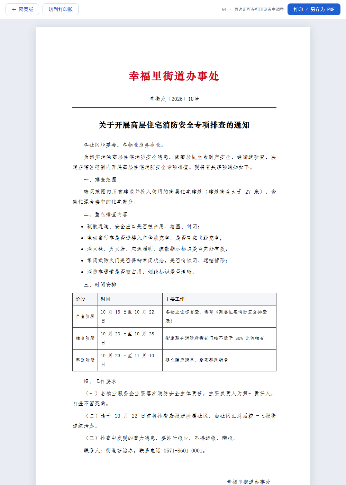

# 居民端与公告发布

> 这份文档记录两块新增能力：**居民入口（第四类使用者）** 与 **上级文件自动发布**。
> 它们补上了此前系统的一个结构性缺口——原来的闭环只发生在三个管理者之间，
> 居民的"反映"和"看到结果"不在系统里，闭环其实是开环的。

> **后续扩展**：本章讲的"文件丢进目录 → 自动发布"只是收文的第一步。
> 完整的 **上级发文 → 社区签收 → 办文落地 → 导出红头 Word** 那条链路，
> 见 `docs/13-收文办文与文档生成.md`。本章第 4 节的三格式解析、
> 打印版与发布版双输出仍然是那份文档的基础。

---

## 1. 为什么居民入口是必需的，而不是"再加一个页面"

原来的链路是：社区工作者录入 → 拆解 → 派单/建档 → 办结。
问题在于：**录入的人不是提诉求的人**。居民的话要经过社工转述一遍，
转述本身就是损耗（漏细节、加主观判断），而且居民无法自己确认"我反映的事有没有人管"。

补上居民端之后，链路才真正闭合成四段：

```
居民填报 → 系统拆解分派 → 社区/物业办理 → 居民查看结果
   ↑                                          │
   └──────────── 不满意可再反映 ←──────────────┘
```

同时这也回答了"系统到底减了谁的负"：不只是减社工的负（不用手写台账、不用手工派单），
也减居民的负（不用跑社区、不用反复打电话问进度）。

---

## 2. 四类使用者与权限分工

| 角色 | 入口 | 能做什么 | 关键权限点 |
|---|---|---|---|
| **居民** | `/portal`（免登录） | 填报问题、查进度、看公告、查三级联系人 | 无账号，凭查询码 |
| 社区工作者 | `/login` | 首录、台账、报表、**发布公告**、置顶 | `notice.manage` |
| 物业 | `/login` | 接单、办结、看公告 | 无公告写权限 |
| 街道 | `/login` | 报表、审计、任务下发、**导入上级文件** | `notice.import` |

**为什么把"导入"和"发布"拆给两个角色**：上级文件由街道这一层接进系统，
但对外发布是属地背书行为——发错了是社区担责。两权分离后，
上级文件进来必须经过社区看一眼才能对居民可见。
自动发布只在"标题 + 发文单位都解析出来"时才生效，其余一律转待确认。

---

## 3. 居民身份：为什么不做账号体系

三个方案对比过：

| 方案 | 门槛 | 隐私 | 代价 |
|---|---|---|---|
| 手机号 + 短信验证码 | 中 | 中 | 要接短信服务，有成本，毕设阶段只能模拟 |
| 建居民账号 | 高 | 中 | 要记密码，老年居民基本用不了 |
| **手机号 + 6 位查询码**（采用） | 低 | 高 | 码丢了要人工找回 |

选第三条的理由：

1. **零门槛**。居民填一次就能提交，不用注册、不用等验证码。社区场景里，
   多一步操作就有一批人放弃。
2. **不存密码就没有密码泄露风险**。`resident_ticket` 表里只有手机号、查询码和内容，
   没有凭据。
3. **双因子查询**。查进度要"手机号 + 查询码"同时对上，只泄露一个拿不到别人的单子。
4. **会话只记本机提交**。`session["portal_tickets"]` 存最近 10 条，
   换设备就用手机号+码查——既方便又不依赖登录态。

对应地，`/api/portal/ticket/<id>` 会校验 `tid in session["portal_tickets"]`，
防止遍历 id 拿到别人的记录。

**返回字段也做了收窄**：只给业务类型、承办单位、状态、时限、处理反馈；
不返回 `fields_json`、不返回内部 id 链路，手机号一律 `138****1111`。

---

## 4. 公告：一个文件夹，放进来自动发布

### 4.1 为什么用"文件夹投递"而不是"后台富文本编辑器"

上级单位的文件本来就是文件（Word、PDF、转发来的文本），让办公室的人登录后台
重新排版一遍，等于多一道人工，也容易改错政策措辞。所以设计成：

```
data/notices/  ← 把文件丢进这里
      ↓ 启动时同步扫一次 + 后台每 60s 轮询目录
   解析 → 编排 → 去重 → 发布 / 待确认
```

**"自动"要真的自动。** 只在启动时扫一次，运行期间丢进去的文件仍然得点按钮或重启，
那只是把手工动作挪了个位置。所以应用启动后还会拉起一个守护线程
（`app/notice/watcher.py`）按 `NOTICE_SCAN_INTERVAL`（默认 60s，0 关闭）轮询：

- **只看目录指纹**（文件名 + mtime + 大小），没变化就不解析，避免每分钟重复读 docx；
- **线程内自带 app context**，后台线程没有请求上下文，不包一层直接用 `db` 会抛
  `RuntimeError`，而线程里的异常没人接管，表现就是"功能静默失效"；
- **异常全部吞掉并记日志**，一轮失败不能让线程死掉；
- 重复扫描是安全的：`source_hash` 去重，dev 重载的父子双进程、多 worker 都只是多扫几次，
  不会产生重复公告——这是"敢开定时任务"的前提。

> 踩到的两个竞态，都已修并固化为用例（`scripts/smoke_autoscan.py` 13 项）：
> ① 初始目录指纹原本在**线程体内**采集，线程调度晚于"用户写入文件"的那一瞬间时，
> 这份文件会被当成初始状态、永远检测不到变化——改为在启动线程**之前**由主线程采集；
> ② 去重原本只按内容哈希，上级改了同一份文件后哈希变了、找不回原记录，
> 于是**多出一条重复公告**——改为哈希找不到时再按文件名认回原记录。

### 4.2 三种格式的解析策略

| 格式 | 元信息来源 | 可靠性 |
|---|---|---|
| `.md` | 文件头 YAML（title / issuer / doc_no / issued_at …） | **最高**，字段明确不会认错 |
| `.docx` | 按公文排布猜：首行标题 → 文号 → 落款 → 日期 | 中，格式规范时准 |
| `.txt` | 首行标题 + 末尾落款，正则抽文号与日期 | 中低，缺字段靠人工补 |

`docx` 还会把文档里的表格按行列转成 Markdown 表格，保证发布版能显示。

### 4.3 置信判决：宁可不发，不可发错

```python
missing = [k for k, v in (("标题", title), ("发文单位", issuer)) if not v]
data["complete"] = not missing
```

标题和发文单位缺一不可。缺任何一个：

- `status = pending`，居民端不可见；
- `parse_note` 记录缺什么（如"未识别到发文单位"）；
- 社区在内部端点开，补全后点"确认发布"。

这条规则的代价是偶尔多点一下，收益是**不会把"关于××的通知"错认成发文单位**。
政务信息一旦挂出去，撤回是有痕迹的。

### 4.4 去重与更新

`source_hash` 存文件内容的 SHA-256：同一份文件重复扫描直接跳过；
文件改过（哈希变了）则更新正文并保留原 id。这样"重新下发一版"不会产生两条公告。

### 4.5 落款剥离（一个容易漏的细节）

公文正文最后两行通常就是：

```
幸福里街道办事处
2026年10月15日
```

而页面底部另有独立的签名区。不处理的话，落款会显示两遍。
`_strip_signature()` 从末尾往回最多剥 3 行，只剥"等于发文单位"或"整行就是日期"的行，
避免误删正文里恰好提到单位的句子。

---

### 4.6 置顶：决定"先看到谁"，而不是"能不能看到"

发布和置顶是两件事，代码里也必须是两件事：

| | 决定什么 | 谁管 | 字段 |
|---|---|---|---|
| 发布 / 下架 | 居民**能不能**看到 | `notice.manage` | `status` |
| 置顶 | 居民**先看到**哪一份 | `notice.manage` | `pinned` + `pinned_at` |

**为什么不新开权限点。** 排在第一位的文件，居民最先读到、最先照办，
这个影响和"发不发"是同一量级的责任，不该拆给两个人。
所以沿用 `notice.manage`，街道与物业都看不到这个按钮。

**为什么除布尔值外还要记 `pinned_at`。** 只翻 `pinned` 的话，
几条同时置顶的记录只能按发稿时间排——后置顶的那条反而排在后面，
"置顶"就退化成了一个筛选标签。加上时间戳后排序是
`pinned DESC, pinned_at DESC, created_at DESC`：后置顶的在上，
未置顶的 `pinned_at` 为 NULL，DESC 时自然让位到最后。
老库升级时按 `COALESCE(published_at, created_at)` 回填，避免升级后旧置顶件排到新置顶件后面。

**为什么有上限（`MAX_PINNED = 3`）。** 满屏都是置顶等于没有置顶，
居民端第一屏也放不下。到上限时**明确拒绝**并提示先撤一条，
而不是静默把最早那条挤下去——静默挤掉会让人以为自己置顶成功了，实际没生效，
这种"以为改了其实没改"比不让改更糟。

**置顶不等于发布。** 未发布、已下架的文件都可以置顶（内部列表先排好），
但 `visible_query()` 仍然只认 `status='published'`，居民端看不到。
接口在这种情况下会在返回语里补一句"该公告尚未发布，居民端暂时看不到"，
否则很容易被理解成"置顶等于发布"，成了绕过审核的暗门。

**两处列表排序刻意不同。** 内部列表按 `created_at`（维护视角看"最近进来的"），
居民端按 `published_at`（居民视角看"最近发布的"），但两边都以 `pinned` 优先。
同一份数据，两种读者，排序口径跟着读者走。

---

## 5. 两种输出：打印版与发布版

公告详情页给三个出口，**不是三套内容，是三套版式**：

| 出口 | 用途 | 版式特征 |
|---|---|---|
| 网页版 | 手机上阅读 | 卡片式，跟随居民端设计 |
| **打印版** | 打印留存、A4 归档 | `@page A4`，宋体小四，带打印时间与来源文件 |
| **发布版** | 对外张贴、上报 | 红色发文机关标志 + 红色分隔线 + 文号居中 + 仿宋三号正文 + 右下落款 |

发布版按《党政机关公文格式》（GB/T 9704-2012）的主要视觉要素做：

- 红头：发文机关名称，红色、居中、加粗，名称超过 10 字自动缩小字号
- 文号：红线之上居中（幸街发〔2026〕18号）
- 标题：二号小标宋，居中
- 正文：仿宋三号（16px），行距 1.85，首行缩进 2 字符
- 落款：右对齐，单位 + 成文日期

打印时自动隐藏工具栏（`@media print { .toolbar { display: none } }`），
按钮一律 `window.print()`，用户可以直接"另存为 PDF"。



> 严格公文页边距是上 3.7 / 下 3.5 / 左 2.8 / 右 2.6 cm，
> 但浏览器打印默认边距不可控，页面内统一按 2.0/2.2 cm 出，
> 需要严丝合缝时在打印设置里改，页面上有提示。

---

## 6. 正文渲染：为什么自己写 60 行而不用 Markdown 库

公告正文来自**外部文件**，渲染的第一要求不是功能全，而是**不能被注入**。

自己实现的顺序是固定的：

```
整段文本 html.escape()  →  再在转义结果上插入受控标签
```

所以 `data/notices/` 里的文件写 `<script>alert(1)</script>`，页面只会显示这行字面量。
（`scripts/smoke_portal.py` 里有这一项断言。）

支持的结构刚好够用：标题、段落、无序/有序列表、引用、表格、`**加粗**`、行内代码。
链接只保留文字不生成 `<a>`——居民端不应该因为一份外部文件跳到不可控站点。

---

## 7. 踩到的三个坑（都是真问题）

### 7.1 系统代理把本地模型调用打死（最隐蔽）

现象：居民提交 0.02 秒返回，`llm_used: false`，事项摘要变成原文截断。
`/api/health` 却显示 `llm.available: true`。

原因：本机设了 `http_proxy=http://127.0.0.1:6xxxx`，`requests` 默认把所有请求
交给代理，**包括发往 `127.0.0.1:11434` 的 POST**。代理不认识这个内网地址，
回 `404 /api/chat`。而 `is_available()` 用的是 GET `/api/tags`，代理恰好放行，
于是健康检查显示正常、实际调用全失败。

修复：

```python
_LOCAL = requests.Session()
_LOCAL.trust_env = False     # 只认 OLLAMA_BASE_URL，不读代理环境变量
```

同样处理了 `app/kb/store.py` 的 `/api/embed`。

**这个坑值得记住的地方**：它不会报错，只会"安静地变差"。
要不是居民端的摘要一眼看出是原文截断，很容易带着降级状态去答辩。

### 7.2 Ollama 进程没继承 `OLLAMA_MODELS`

现象：`/api/tags` 返回 `{"models":[]}`，`/api/chat` 404。

模型其实在 `F:\ollama-models`，用户级环境变量也设了，但当前 `ollama serve`
是在变量生效前被托盘程序拉起的，进程环境里没有这一项，于是去 C 盘默认目录找模型。

修复：停掉 `ollama app.exe` 与 `ollama.exe`，带 `OLLAMA_MODELS` 重新 `ollama serve`。
`启动系统.bat` 里已经有兜底：变量为空且 `F:\ollama-models\manifests` 存在时自动补。

### 7.3 移动端截图看着"右侧被裁"，其实不是布局问题

验收居民端时截图总在右边切掉一条。查了才发现 headless Chrome 受系统 DPI 影响：
`--window-size=414` 下 `document.documentElement.clientWidth` 实测是 **497**，
截图却按 414 像素输出，于是布局的右侧 17% 被裁在画面外。

用 DOM 度量确认布局是对的：

```
VW=497  MAIN=0..497  CARD=14..483  RIGHTGAP=14  STAFF=385..479
```

卡片右边距 14px，工作人员按钮完全在视口内。**结论是截图工具的问题，不是样式的**。
顺手补的 `min-width: 0`（flex 子项）仍然保留——中文不断词，长字符串撑破容器的风险是真的。

### 7.4 缺发布日期的 md 会让整个文件解析失败

现象：写自动化用例时发现，一份**只写了 title、没写 `issued_at`** 的 md 直接抛
`UnboundLocalError: cannot access local variable 'body_text'`。

原因：`parse_markdown` 里 `issued_at = ... or _find_date(body_text) ...` 这一行
排在 `body_text = "\n".join(body_md)` **之前**。Python 的 `or` 是短路求值——
front matter 里有 `issued_at` 时 `_find_date(body_text)` 根本不会执行，
所以样例文件全都没触发；一旦上级给的 md 没写日期，就会炸。

修复是把 `body_text` 的首次计算提到使用它之前，剥落款后再重算一次（摘要不含落款）。
**这个 bug 的教训比修复本身重要**：短路求值会掩盖未初始化变量，
"样例数据全都正常"不等于"代码正确"——得靠构造缺字段的用例去顶。

### 7.5 办理进度页整页 500：Jinja 里 `view.items` 拿到的是 dict 的方法

现象：居民提交成功后点"查看办理进度"，页面显示一串 JSON：

```json
{"code":500,"debug":"ticket.html, line 20, in block 'body' | 
 TypeError: 'builtin_function_or_method' object is not iterable","msg":"服务内部错误…"}
```

原因：视图函数把 `_ticket_payload(t)` 作为 `view` 传进模板，它是个 **dict**。
模板写 ``，Jinja 的属性查找先看属性再看键，
而 dict 自带 `.items` 方法，于是拿到的是**绑定方法**而不是名为 `items` 的那个键。
`for` 循环一个内置方法 → `TypeError` → 整页 500。

修复：改用下标取值 ``。
**不要为了绕过它去改接口字段名**——`items` 是对外 JSON 契约（`/api/portal/ticket` 也在用），
改字段会把前端和其他调用方一起打断。

顺带两处：
- 状态徽标原来写死 `class="lv community"`（业务线配色，绿底），"已受理"显示成绿色，语义是错的；
  改为按状态取 `tag tag-open/doing/done`，与页头徽标同一套颜色。
- 居民端 `base.html` 补了内联 SVG favicon，否则控制台总有一条 `/favicon.ico` 404，
  排查真问题时容易被这条噪声带偏。

**为什么之前 26 套测试没抓到**：`smoke_portal` 只断言了 `/portal/done/<id>`（提交成功页），
没有 GET 过 `/portal/ticket/<id>`（进度页）。已补 7 项断言，包括"渲染成 HTML 而非错误 JSON"、
"列出拆出的事项"、"新设备凭码找回能打开"、"无会话被拒"。

修复后（390 宽手机视口，滚到底）：状态徽标与页头同色、事项卡完整、底部导航不压正文。


---

## 8. 测试

`scripts/smoke_portal.py`，**80 项全过**，用独立库 `data/smoke_portal.db`，
并把 `OLLAMA_BASE_URL` 指向一个必然连不上的地址强制走规则路径，
保证测试确定性、不依赖 GPU：

| 组 | 覆盖 |
|---|---|
| 可访问性 | 6 个居民页 200；首页有工作人员入口；引用独立 CSS；登录页有居民入口 |
| 导入 | 三种格式各解析出结果；自动发布 ≥3；缺发文单位进待确认；表格进正文；落款已剥离 |
| 输出 | 网页版/打印版/发布版各自 200；红头与文号存在；`@page A4`；工具栏打印时隐藏；待确认公告 404 |
| 闭环 | 提交 → 6 位码 → 查询；手机号打码；不返回 `fields_json`；各种错误码 |
| 防刷 | 前 5 次放行，第 6 次拦截 |
| 权限 | 物业/街道/社区 9 种组合；未登录 302 / 401 |
| 状态机 | 待确认 → 补全 → 发布 → 下架，每步状态与可见性正确 |
| 去重 | 第二次扫描全部跳过 |
| 留痕 | 公告操作写审计；工单内容不含明文手机号 |

复跑：

```bash
python scripts/smoke_portal.py
```

另有两只专项用例，分别守住"安全边界"和"自动化的自动程度"：

| 脚本 | 项数 | 守的是什么 |
|---|:---:|---|
| `scripts/smoke_security.py` | 32 | 未登录 401；物业跨主体接单/办结 403 且不泄单号、不写坏数据、留 deny 审计；居民读不到 `scope≠all` 的公告；登录 5 次失败后 429 且锁定期间正确密码也拒；**IP 逐次变化时账号维度仍锁得住**；单 IP 扫号被兜底；prod 不用默认密钥、密钥落盘可跨重启复用；Cookie 带 HttpOnly + SameSite |
| `scripts/smoke_autoscan.py` | 13 | 运行期间丢文件**不重启**即上线；缺发文单位转 pending；目录不变反复扫不重复入库；改文件是更新不是新增；关闭开关后不再扫 |
| `scripts/smoke_pin.py` | 48 | 置顶权限（街道/物业 403、未登录 401）；不传参时按状态取反；多条置顶按时间倒序；取消后回落时间排序；上限 3 条且拒绝时不挤掉旧件；`counts.pinned` 与明细同源；**未发布/已下架的置顶件居民端不可见**；满额时按钮置灰并说明原因；pin/unpin 各留审计；PATCH 补全也维护 `pinned_at` |

安全用例存在的意义不只是抓当下的 bug——**修一次性的问题靠手测够用，
安全边界必须靠断言守住**，否则下次改接口很容易把隔离再漏一遍。

---

## 9. 局限与后续

1. **查询码找回靠人工**。居民丢了码只能打社区电话核实身份。要自动化就得有账号体系，
   与"零门槛"目标冲突，暂不做。
2. **公告无阅读回执**。目前只有"发布"，没有"已读/未读"统计，无法回答
   "这条通知到底有多少居民看到了"。
3. **PDF 格式未支持**。上级单位发 PDF 很常见，但 PDF 抽正文需要额外交付
   （版式还原、表格识别），当前会在扫描结果里报"暂不支持的格式"。
4. **居民端无图片上传**。报修时拍一张照片比文字准确得多，这是最该补的一项；
   需要处理存储、压缩与脱敏（照片里的人脸、门牌）。
5. **公告未接入推送**。理想状态是发布后微信/短信通知到户，当前只能靠居民主动打开。
